# ✈ Flight Clock (and more)

A Raspberry Pi clock on a 64×32 RGB LED panel. It shows the time and weather, and the planes flying over your house: airline, flight number, where each one is coming from and going to, and whether it's running late. On top of that it rotates through whatever else you turn on: sports scores, stocks, your calendar, ski reports, what's playing on Spotify, and more.

Everything is set up from a web page on your phone or computer: no config files, no command line after the install.

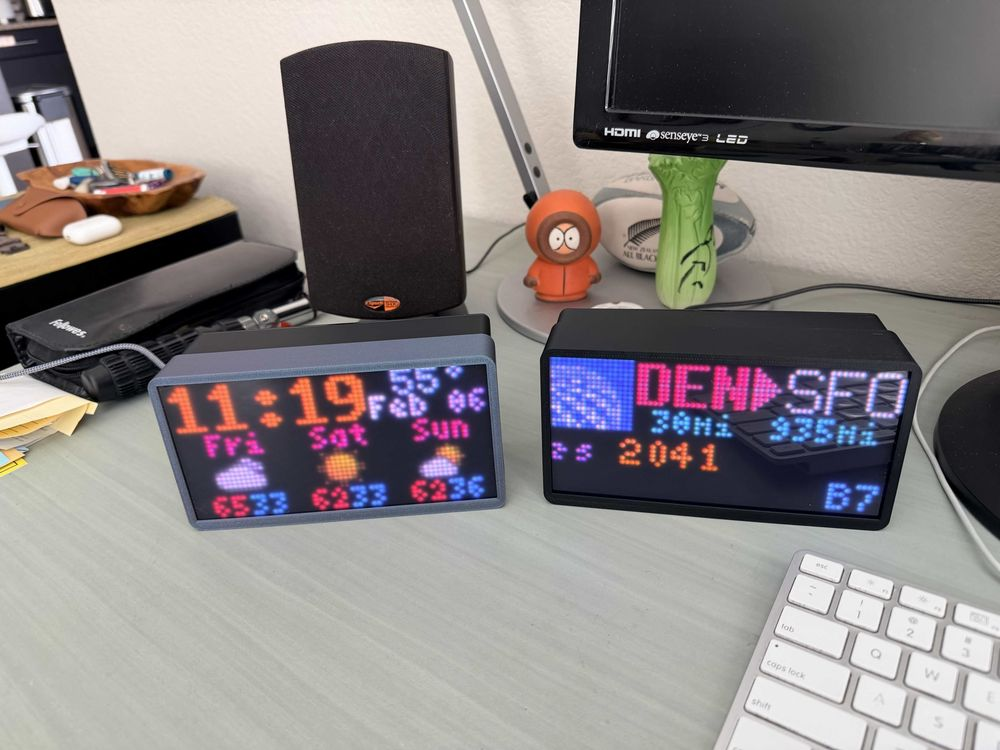

| A plane overhead | Clock, weather and alerts | A flight, then the news |
|:---:|:---:|:---:|
| 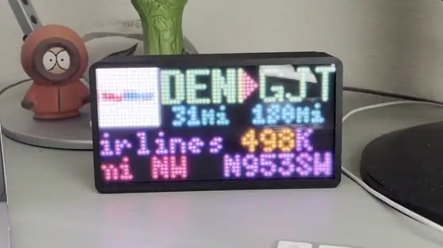 | 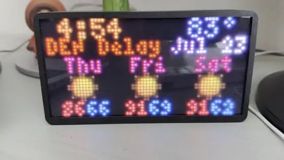 | 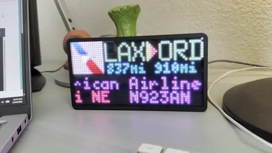 |

> **Want one without building it?** I'll build a Flight Clock for you: **$230–250**, depending on the panel and case. Email me at [rdhobbs@gmail.com](mailto:rdhobbs@gmail.com?subject=Flight%20Clock%20build). See [Have one built for you](#have-one-built-for-you).

> **Don't have a Pi?** Run Flight Clock on your **Mac or Windows PC** instead: same modules, in a window or on your desktop, with extra looks the LED panel can't do (vintage airport flip board, colour e-ink, retro clock cases, music visualizers).
> → **[Download Flight Clock for Mac and Windows](https://github.com/RoyMan0/Flight-Clock-App/releases/latest)**

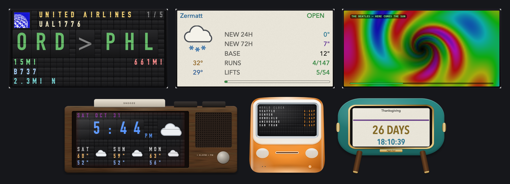

---

## What it can show

Turn on any of these and set their order and time on screen:

| Module | What it shows |
|---|---|
| **Clock & Weather** | Time, date, temperature, and the next 3 days (or Morning / Afternoon / Evening / Night). Weather, airport and ISS alerts. |
| **Overhead Flights** | Planes passing overhead: airline logo, route, delays colour-coded, aircraft type, distance and altitude. Interrupts the rotation when one appears, with an optional chime. |
| **Specific Flight Tracker** | A flight you name, from takeoff to landing: progress, time left, speed, altitude, and what it's flying over. |
| **Sports** | Live and upcoming games for your leagues and teams, with score alerts. |
| **Stock Ticker** | Your symbols and market indexes. |
| **Calendar** | Upcoming events from iCloud, Google or any calendar link, with reminders. |
| **Snow Report** | New snow, base, runs and lifts open, and the forecast for ski resorts anywhere. |
| **Now Playing** | The song on Spotify, Apple Music (on your Mac) or anything that scrobbles to Last.fm, as album art or EQ visualizers. |
| **Transit** | Train and bus arrivals for your stops (Chicago, Denver, New York and more). |
| **World Clock** | The time in any cities you pick, coloured by day and night. |
| **World Daylight** | A world map with the day/night line, the sun and the moon. |
| **Breaking News** | AP headlines. |
| **Event Countdown** | Days, hours and minutes to your big day. |
| **System Stats** | CPU, memory, temperature and network for the Pi and your other computers. |
| **AI Usage** | Your Claude and ChatGPT plan limits. |
| **Maze** | Watch it build and solve mazes, or play one from your phone. |

The web page also has a live mirror of the panel, flight logs and maps (closest and farthest planes you've spotted), and a Display page to show any module on demand.

| | | |
|:---:|:---:|:---:|
| 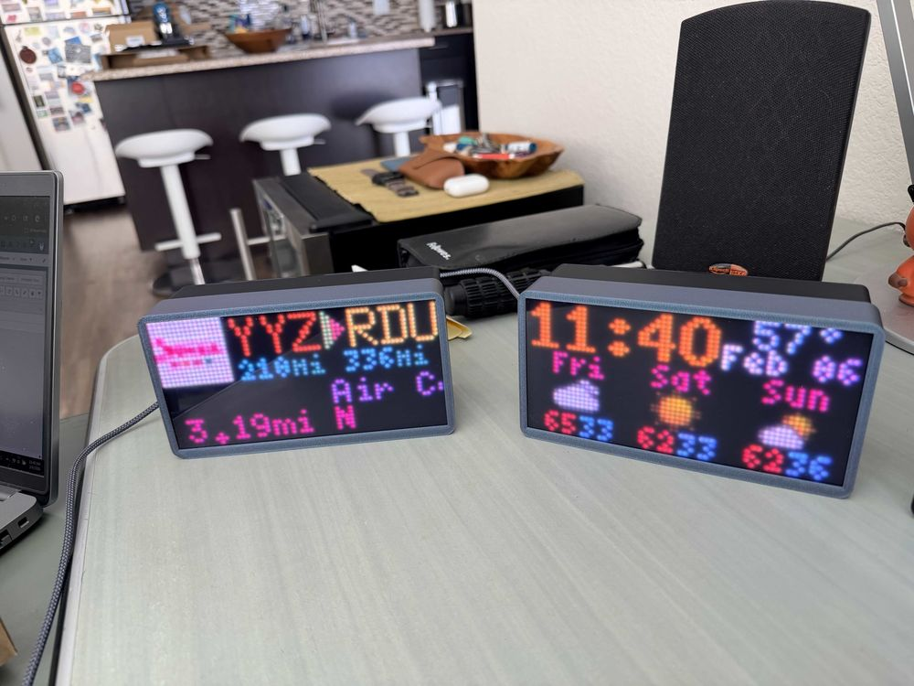<br>A flight and the clock | 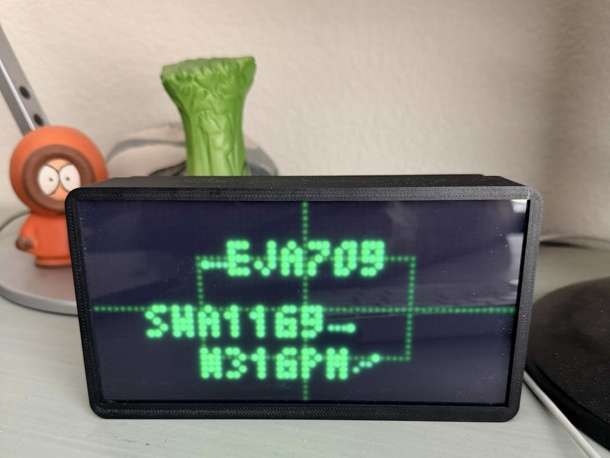<br>Radar view | 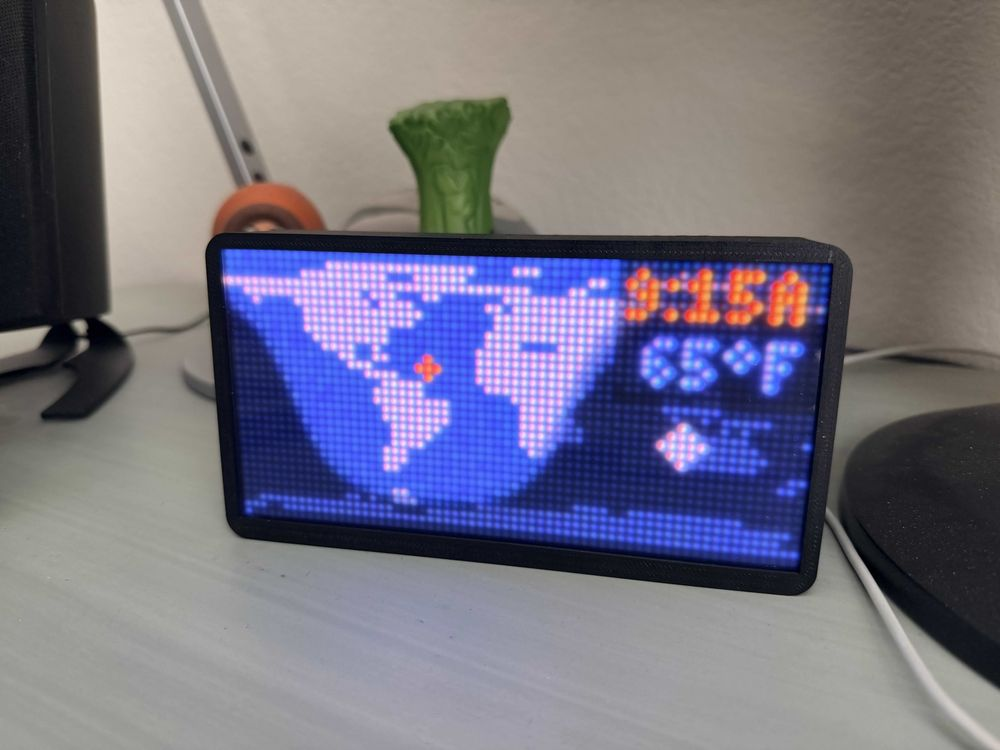<br>World Daylight |
| 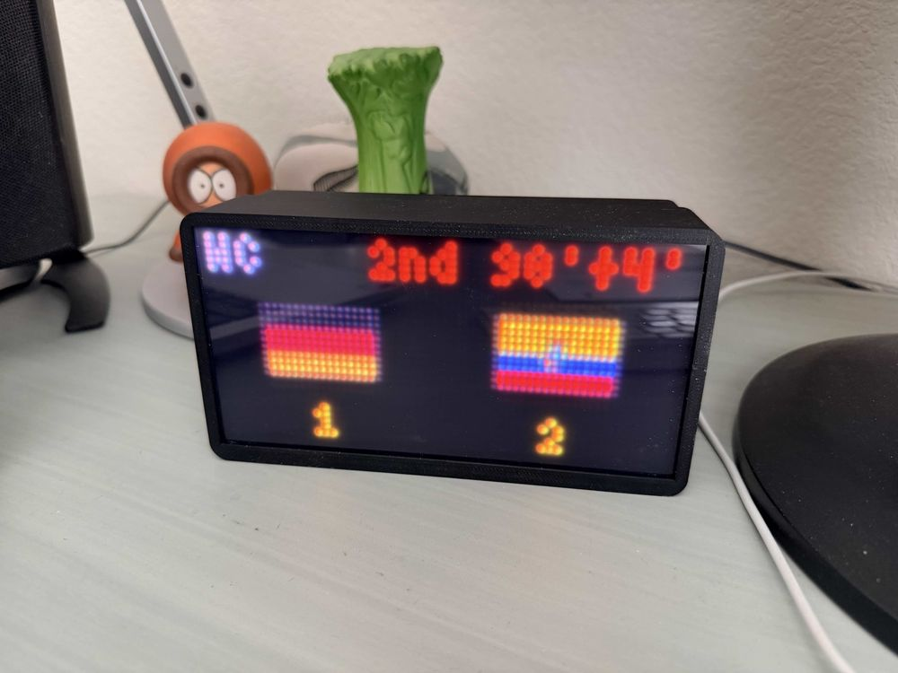<br>Sports | 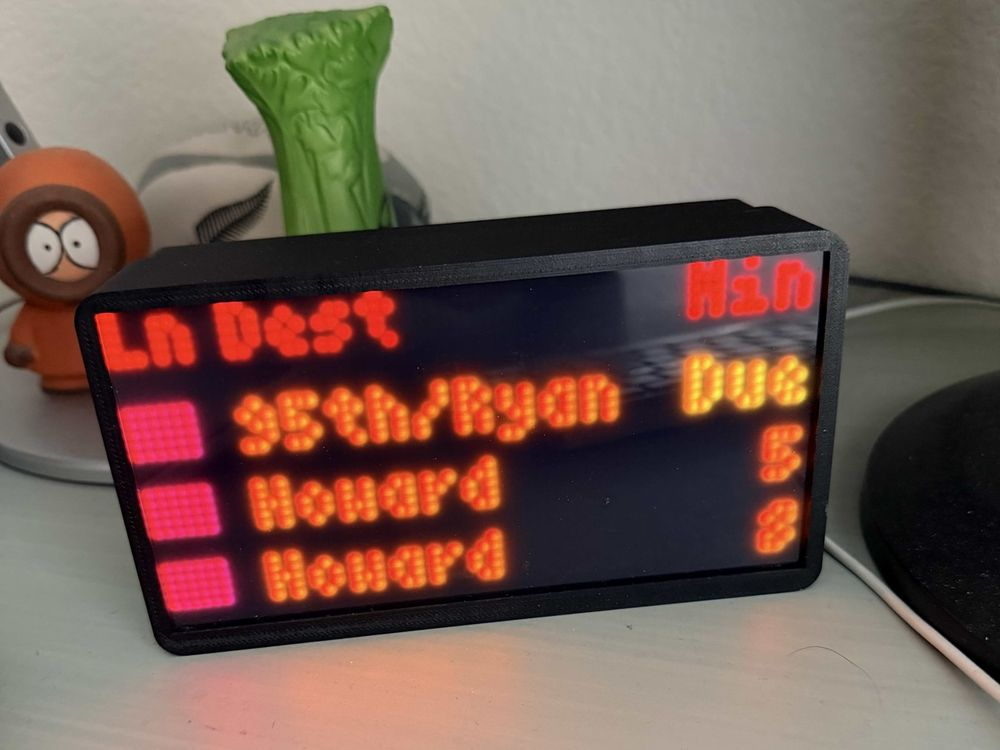<br>Transit | 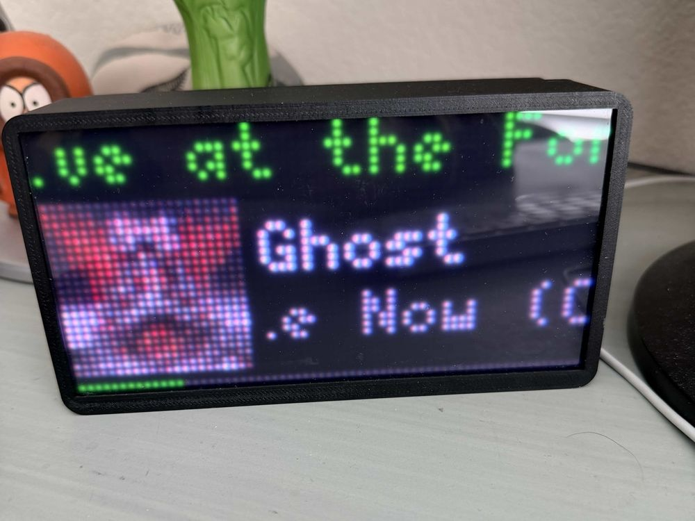<br>Now Playing |
| 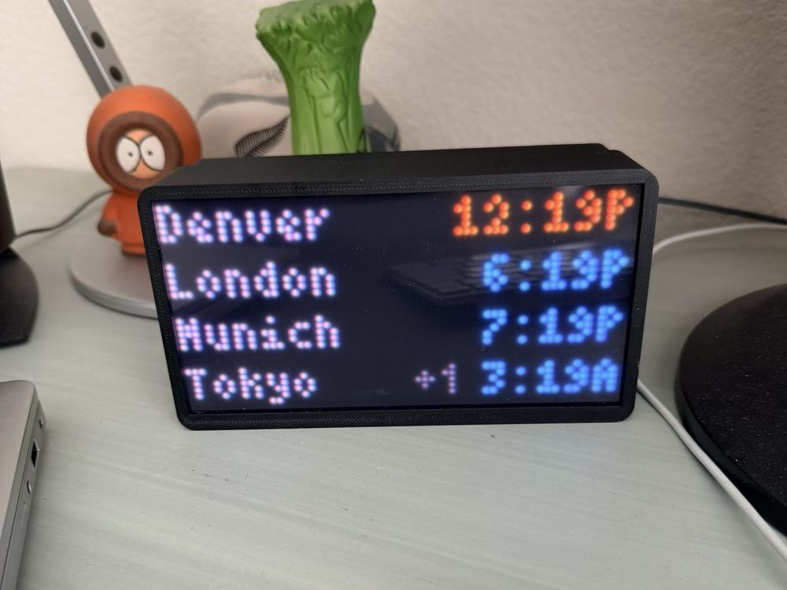<br>World Clock | 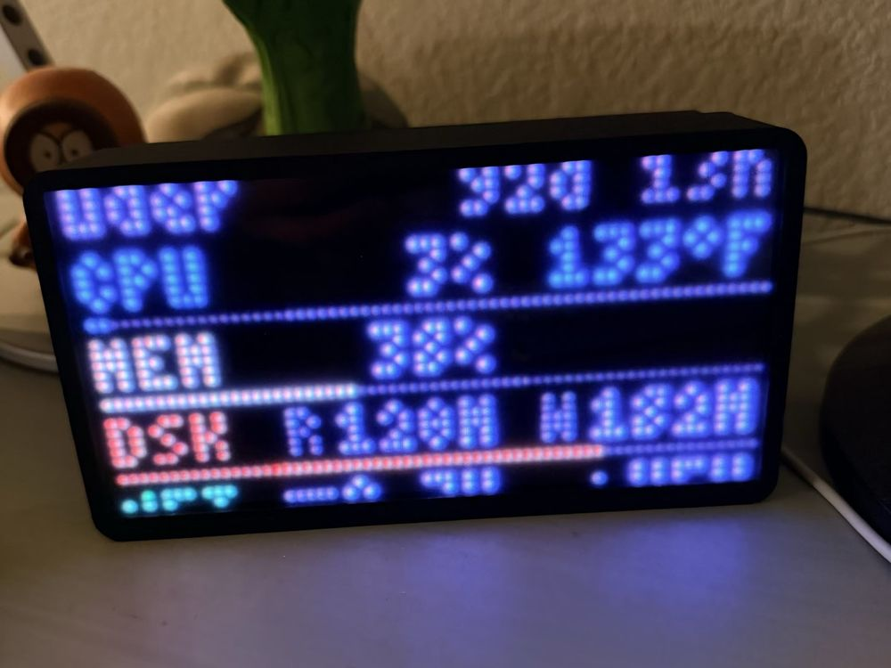<br>System Stats | 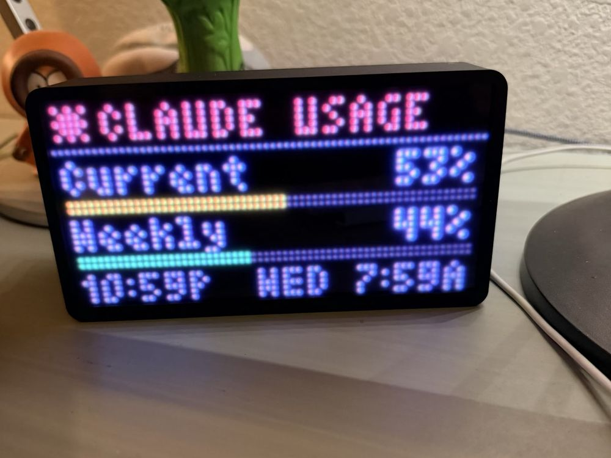<br>AI Usage |
| 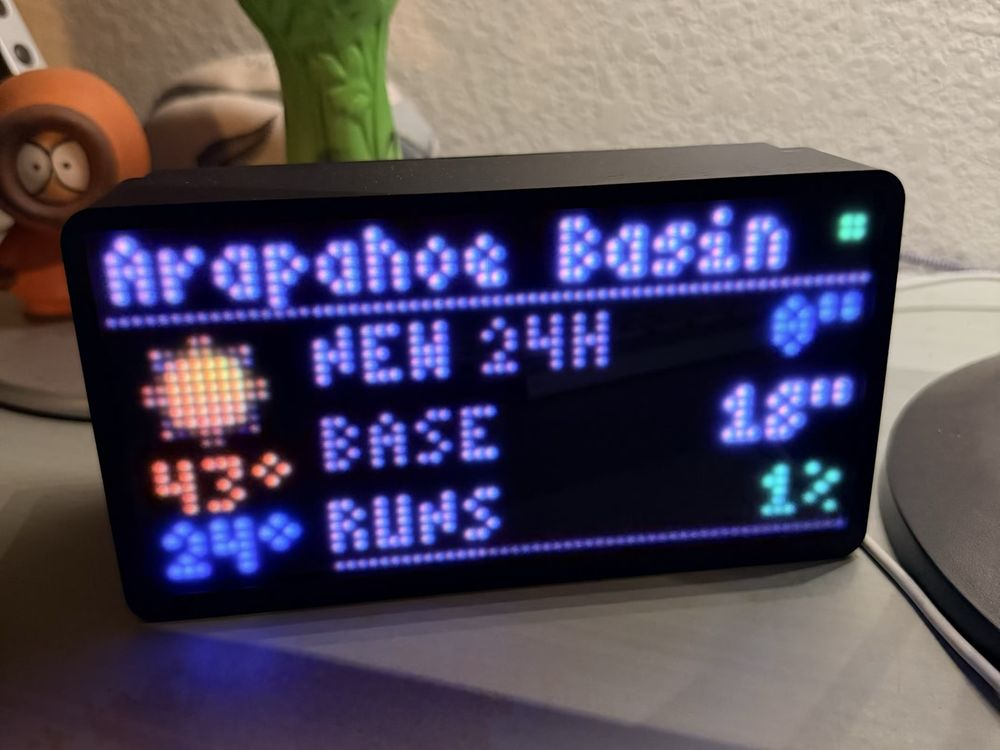<br>Snow Report | | |

---

## What you need

| Part | Notes |
|---|---|
| [Raspberry Pi 3A+](https://www.adafruit.com/product/4027) | A 3B+ or 4 also works. A Pi Zero flickers; a Pi 5 isn't supported by the LED library yet. |
| [Adafruit RGB Matrix Bonnet](https://www.adafruit.com/product/3211) | Sits on the Pi and drives the panel. |
| [64×32 RGB LED panel, P4](https://www.adafruit.com/product/2278) | About 10 × 5 in. Any 64×32 panel works: P3 or P2.5 for a smaller clock. |
| [USB-C to 5 V barrel adapter](https://www.adafruit.com/product/6030) | Plugs into the bonnet, which powers the panel *and* the Pi, so a phone charger is all you need: any USB-C charger of **10 W or more**, or a USB-C port on a computer or laptop. |
| [Tinted acrylic](https://www.adafruit.com/product/4749) + [clear double-sided tape](https://www.amazon.com/EZlifego-Multipurpose-Removable-Transparent-Household/dp/B07VNSXY31) | Optional, but it makes the panel much easier to read. The acrylic is a little larger than a P4 panel. |
| microSD card | Any size, 8 GB or more. |
| [Small CPU heatsink](https://www.adafruit.com/product/3084) | |
| [2×20 stacking header](https://www.microcenter.com/product/480891/schmartboard-inc-schmartboard-inc-short-2x20-female-stackable-headers-qty-4) | Lifts the bonnet clear of the heatsink (not needed with the small heatsink above). |
| M2.5 screws | To hold the bonnet on the Pi and the Pi in the case. |
| Case | A 3D-printed case (link coming soon), or build one from wood. |
| Bluetooth speaker | Optional, for the plane and score sounds. |

A soldering iron is only needed for the optional PWM bridge on the bonnet (GPIO 4 to 18), which makes the panel smoother. The Pi 3 looks fine without it.

---

## Have one built for you

Don't want to solder, print a case or run an installer? I'll build one for you: **$230–250**, depending on the parts.

- **What you get:** a finished clock (Raspberry Pi, bonnet, 64×32 LED panel, tinted acrylic front, 3D-printed case and USB-C power adapter) with the software installed and tested.
- **What changes the price:** the panel size (P4 is about 10 × 5 in; a smaller P3 or P2.5 is also possible), the case colour, and whether you want a USB-C charger included.
- **Setting it up:** plug it into any USB-C charger (10 W or more) or a computer's USB-C port, and it shows a QR code to join its **FltClk** Wi-Fi from your phone. Pick your home Wi-Fi, then the setup wizard asks for your location and modules. No computer needed. Afterwards, change anything from the clock's web page on your home network (see [Finding your clock's web page](#finding-your-clocks-web-page)).

Email me at **[rdhobbs@gmail.com](mailto:rdhobbs@gmail.com?subject=Flight%20Clock%20build)** with what you'd like and roughly where you are (for shipping), and I'll get back to you with a price and timing.

---

## Install

You'll need a computer with an SD card reader for the first step. It takes about 30 minutes, most of it waiting.

### 1. Put Raspberry Pi OS on the SD card

1. Install **[Raspberry Pi Imager](https://www.raspberrypi.com/software/)** and choose **Raspberry Pi OS Lite (64-bit)**, under *Raspberry Pi OS (other)*. Lite is the version **without a desktop**: the clock runs headless, and you set it up from your phone or computer, so no monitor, keyboard or mouse is needed. (The regular desktop version wastes memory the Pi needs and can make the panel flicker.)
2. In the Imager's settings, set:
   - a **hostname** (e.g. `flightclock`), a **username** and **password**,
   - your **Wi-Fi** name and password (exactly, it's case-sensitive),
   - your **time zone**,
   - and turn on **SSH** (password login).
3. Write the card, put it in the Pi with the bonnet and panel attached, and plug in the power.

### 2. Connect to the Pi

From a terminal on your computer (Terminal on a Mac, PowerShell on Windows):

```bash
ssh yourusername@flightclock.local
```

If that name isn't found, use the Pi's IP address instead (`ssh yourusername@192.168.x.x`); your router's list of connected devices shows it.

### 3. Run the installer

```bash
sudo apt install -y screen
screen -S install
curl -fsSL https://raw.githubusercontent.com/RoyMan0/flight-clock-and-more/main/install.sh -o install.sh
sudo bash install.sh
```

The installer sets up everything: system packages, the LED library (this part takes 5–10 minutes), the clock, and a service that starts it at boot. `screen` keeps it running if your connection drops; reconnect with `screen -r install`. At the end it can ask for your location and API keys; press Enter to skip them and use the web page instead.

### 4. Finish in your browser

Open your clock's web page on your phone or computer (see below). The setup wizard asks for your location (type your address, or enter latitude and longitude), the modules you want, and your keys. Then it starts the clock.

#### Finding your clock's web page

The clock's settings live on a web page served by the clock itself, at **`http://<your clock's IP address>:8080`**, for example `http://192.168.1.42:8080`.

- It only works **on your home network**: your phone or computer has to be on the same Wi-Fi as the clock. It isn't reachable from the internet.
- **Finding the IP address:**
  - The clock shows it on its screen ("Settings at 192.168.x.x, port 8080") for a few seconds every time it starts, and for a full minute right after the setup wizard. Once you've bookmarked it, you can turn this off in Config → System Settings.
  - The installer prints it at the end ("Web dashboard: http://192.168.x.x:8080").
  - Your router's app or admin page lists it under connected devices, named after your hostname (e.g. `flightclock`).
  - Over SSH: `hostname -I`.
- `http://flightclock.local:8080` (your hostname) also works on iPhones, iPads and Macs, and often on Windows, but not always on Android, so the IP address is the reliable one.
- **Bookmark it**, or on a phone use *Add to Home Screen*, so it's one tap away.
- **Tip:** in your router's settings, reserve the clock's IP address (often called a *DHCP reservation* or *fixed IP*), so the address and your bookmark never change.

If the Pi can't join your Wi-Fi, it makes its own network called **FltClk** and shows a QR code on the panel: scan it with your phone to set up Wi-Fi from there.

### 5. API keys

All free. Only the weather key is needed to start; add others when you turn on the modules that use them (each module's settings say what it needs).

| Service | Used for | Sign up |
|---|---|---|
| **Tomorrow.io** | Weather and forecast | [app.tomorrow.io/signup](https://app.tomorrow.io/signup) |
| **AirLabs** | Flight routes and delays (1,000 lookups a month) | [airlabs.co/signup](https://airlabs.co/signup) |
| **FlightAware AeroAPI** | More flight lookups (about $5 free a month) | [flightaware.com/aeroapi](https://www.flightaware.com/aeroapi/signup/personal) |

Planes overhead are found free (adsb.lol, with OpenSky and Flightradar24 as backups). Routes come from free sources first, and AirLabs and FlightAware fill in the rest, so most planes cost nothing. You can add several keys of each, and the config page shows how many lookups you've used.

---

## Using it

- **Settings:** `http://<your clock's IP>:8080/config` (see [Finding your clock's web page](#finding-your-clocks-web-page)). Every module has a **Test** button that shows exactly what the panel will display.
- **Display page:** show any module now, or play the maze.
- **Updates:** **Check for Updates** on the dashboard pulls the latest version and restarts the clock.
- **Panel looks wrong?** Config → System Settings has the panel options: LED Pixel Order (swapped colours), GPIO Slowdown (flicker), and HAT PWM Mode if you soldered the bridge.
- **Logs:** `journalctl -u its-a-plane -f` over SSH.

---

## Help, ideas and tips

**Need help?** Please [open an issue](https://github.com/RoyMan0/flight-clock-and-more/issues) on GitHub. That's the best way to reach me, and the answer helps the next person with the same problem. Include what you were doing, what you expected and what happened instead; for a Pi problem, the last lines of `journalctl -u its-a-plane -n 50` help a lot.

Ideas for new modules are welcome too, as an issue or with **Issues? Ideas? Contact me!** at the bottom of your clock's web page.

If you enjoy your Flight Clock, tips are always appreciated:

| Venmo | PayPal |
|:---:|:---:|
|  |  |
| [@roy-hobbs](https://venmo.com/u/roy-hobbs) | [paypal.me/royman0](https://paypal.me/royman0) |

---

## Credits

Flight Clock grew out of **[plane-tracker-rgb-pi](https://github.com/c0wsaysmoo/plane-tracker-rgb-pi)** by **c0wsaysmoo**, the overhead flight tracker, clock and weather, and the hardware design this all started from. Their work in turn builds on **[its-a-plane-python](https://github.com/ColinWaddell/its-a-plane-python)** by **Colin Waddell**, with forks and ideas from **[a10kiloham](https://github.com/a10kiloham/plane-tracker-rgb-pi)**, **[yashmulgaonkar](https://github.com/yashmulgaonkar/plane-tracker-rgb-pi)** and **[ajplotkin](https://github.com/ajplotkin/plane-tracker-rgb-pi-f24only)** (who added the alerts). Thank you all.

Since then I've rebuilt a lot of it and added a lot on top: the module system and all the modules beyond the clock and flights, the web setup wizard and config pages, the one-command installer, the flight lookup chain, logs and maps, and the Mac and Windows app.

The LED panel runs on Henner Zeller's [rpi-rgb-led-matrix](https://github.com/hzeller/rpi-rgb-led-matrix). Weather from [Tomorrow.io](https://www.tomorrow.io), aircraft positions from [adsb.lol](https://adsb.lol), [OpenSky](https://opensky-network.org) and [Flightradar24](https://www.flightradar24.com), place names from [GeoNames](https://www.geonames.org) and [OpenStreetMap](https://www.openstreetmap.org).

---

## License

[GPL-3.0](LICENSE), the same license as the original its-a-plane-python this project is built on.
